<div align="center">

# B2CEUS-Net

### Ovarian tumour malignancy prediction from **B-mode ultrasound only**, using CEUS and clinical findings as *privileged information* during training

`Review 1` · `Review 2` · PyTorch · ResNet-18 · Learning Using Privileged Information (LUPI)

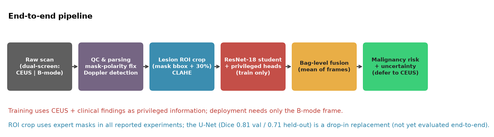

</div>

---

## 💡 The idea in one minute

Contrast-enhanced ultrasound (**CEUS**) is very informative for telling malignant from benign ovarian tumours, but it needs a contrast agent, extra time and extra equipment. Ordinary **B-mode** ultrasound is available everywhere.

So we ask: **can a model that only sees B-mode at deployment still benefit from CEUS and radiologist findings that exist only at training time?**

This is *Learning Using Privileged Information* (teacher → student):

| Stage | What the model sees | Used for |
|---|---|---|
| **Training** | B-mode **+** CEUS **+** 7 radiologist findings | Teacher embedding, clinical-finding head, CEUS-hallucination decoder |
| **Deployment** | **B-mode frame only** | Malignancy probability + uncertainty ("recommend real CEUS?") |

The privileged heads are thrown away at inference, so they cost **nothing** at test time.

---

## 🗂 Dataset at a glance

| | Train / val pool | Held-out test cohort | Total |
|---|---|---|---|
| Bags (one per lesion/scan) | 257 | 67 | **324** |
| Malignant | 83 (≈32 %) | 11 (≈14 %) | **94** |
| Unique patients | 247 | disjoint patients | ~293–312 |

- Every bag has one true privileged pair: a **CEUS frame + the simultaneously captured B-mode frame**, plus 0–3 extra B-mode/Doppler frames, a histopathology label and 7 radiologist findings.
- Single centre, small, and the test cohort has a **different malignancy prevalence** than training → accuracy/F1 must be read with care; AUC is prevalence-invariant.

<p align="center">
  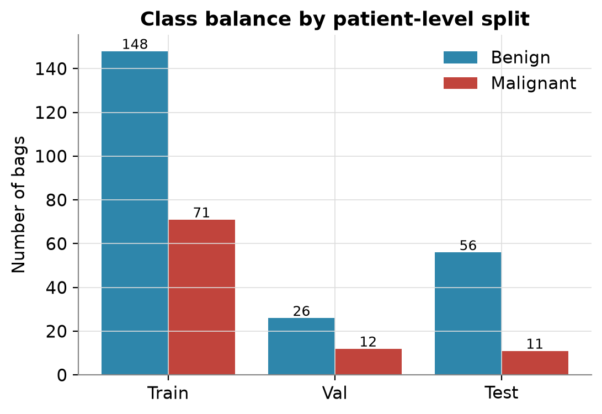
  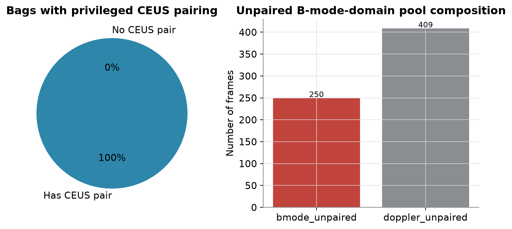
</p>

> ⚠️ **The patient images / labels are not included in this repository** (`Data/` and `labels/` are git-ignored). Only code, configs, figures and result tables are public.

---

# 📘 Review 1 — Baseline, distillation, segmentation

What was built:

1. **EDA + data-quirk discovery** – mask polarity flips between file formats, CEUS/B-mode dual-screen pairing, Doppler frames hiding among B-mode frames, on-screen scanner UI that a classifier could shortcut on (→ lesion ROI crop + 30 % margin).
2. **U-Net lesion segmentation.**
3. **Baseline ResNet-18** on B-mode only.
4. **Teacher–student distillation** (frozen CEUS+B-mode teacher → B-mode student: CE + KD-logits + feature MSE).
5. **Grad-CAM** of the B-mode student.

### Review 1 results (held-out test set: 67 bags, 11 malignant)

| Model | Accuracy | F1 | AUC |
|---|---|---|---|
| Baseline ResNet-18 (B-mode) | 0.776 | 0.483 | 0.828 |
| Distilled student (KD + feature MSE) | 0.851 | 0.444 | 0.839 |
| Teacher oracle (uses real CEUS) | 0.866 | 0.526 | 0.820 |
| Reference benchmark (paper) | 0.73 | 0.65 | – |

| Segmentation (U-Net) | Dice |
|---|---|
| Validation | 0.807 |
| Held-out TestData (unseen patients) | 0.709 |

<p align="center">
  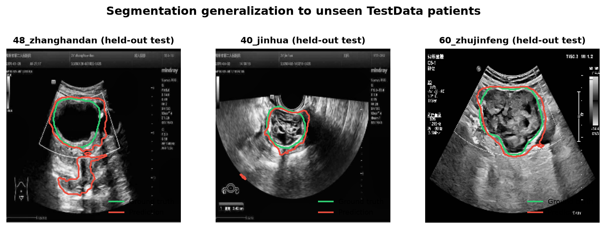<br>
  <em>U-Net predictions on unseen test patients.</em>
</p>

<p align="center">
  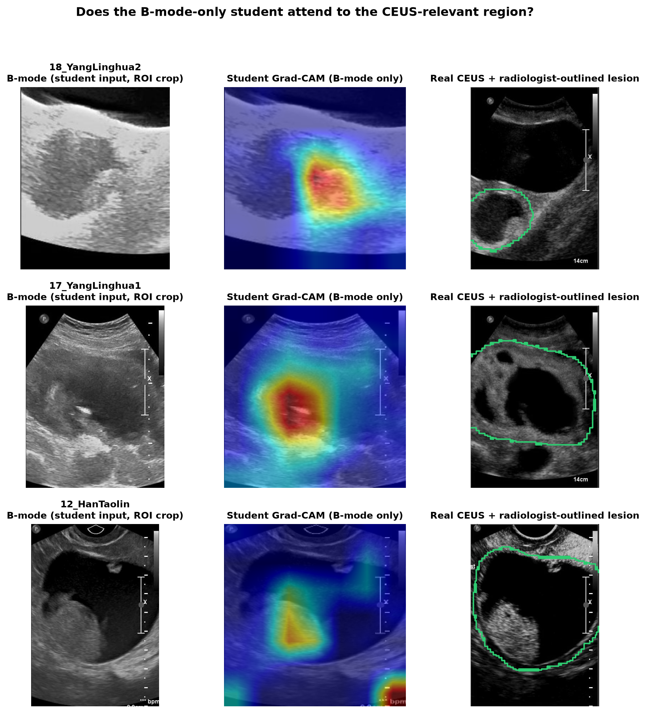<br>
  <em>Grad-CAM of the B-mode-only student next to the real CEUS lesion.</em>
</p>

### Honest critique of Review 1 (this is what drove Review 2)

- The +0.011 AUC from distillation is **noise**: with 67 bags / 11 positives the bootstrap AUC CI is about ±0.11.
- The **teacher (0.820) was not better than the students**, so there was little for distillation to transfer.
- Part of the accuracy gain is a prevalence artefact (14 % test vs 32 % train).
- The uncertainty demo flagged **0 / 199** images (threshold never reached) and the CEUS-synthesis decoder was only a stub.

---

# 📗 Review 2 — Fixing the weaknesses, with rigorous evaluation

## What's new

| # | Addition | Idea |
|---|---|---|
| 1 | **Clinical-finding head** | Predict the 7 radiologist findings (morphology, boundary, solid, separation, nipple, blood flow, internal echo) from B-mode alone – a second, cheaper privileged signal. |
| 2 | **CEUS-hallucination decoder** | Decode a 56×56 *synthetic CEUS* from the B-mode feature map, supervised by the real CEUS. Gives a visual "what would CEUS show" output at zero inference cost. |
| 3 | **Leak-free evaluation** | Patient-level 5-fold CV with a **per-fold teacher**, cluster bootstrap, 3-seed ablation, held-out cohort. |
| 4 | **Working uncertainty rule** | Ensemble entropy + seed disagreement → "defer to real CEUS". Replaces Review 1's non-functional demo. |

Final loss: `CE + 1.0·MSE_feat + 0.25·BCE_clinical + 0.1·L1_recon`

<p align="center">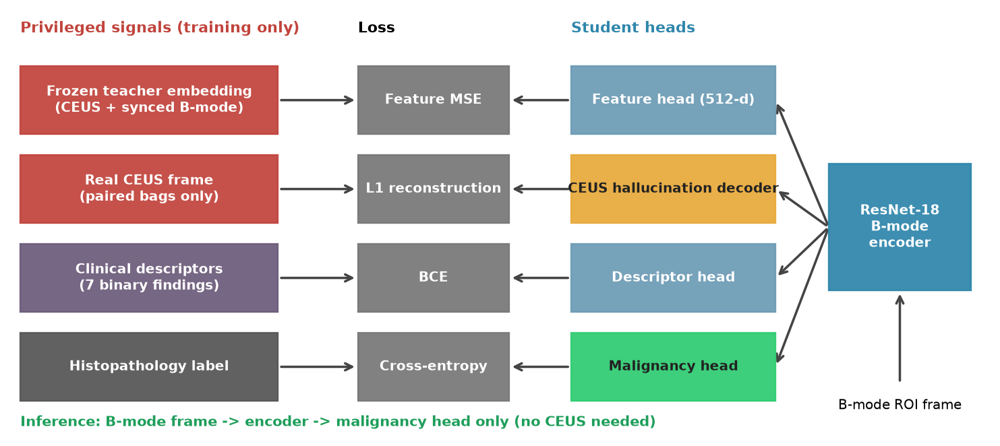</p>
<p align="center">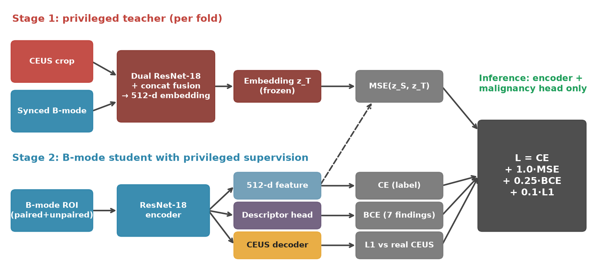</p>

## Protocols

| Protocol | Purpose | n |
|---|---|---|
| **A. 5-fold patient-level CV** (per-fold teacher) | **Primary** result – most positives, no test reuse | 257 bags / 83 malignant |
| **B. 3-seed ablation, 11 variants** | Seed variance on the official test set | 67 bags / 11 malignant |
| **C. 5-fold-model ensemble on test cohort** | External-cohort check | 67 bags |

Same ResNet-18 (ImageNet init), Adam 3e-4, batch 16, ≤12 epochs, early stopping on validation AUC for every variant.

## Results

### A. Primary: 5-fold CV, pooled out-of-fold predictions

| Variant | OOF AUC [95 % CI] | Fold AUC (mean ± SD) | AUPRC | Sens | Spec | Brier | ECE | ΔAUC vs baseline [95 % CI] | p | Folds better |
|---|---|---|---|---|---|---|---|---|---|---|
| Baseline (B-mode CE) | 0.767 [0.687, 0.838] | 0.782 ± 0.132 | 0.689 | 0.578 | 0.897 | 0.166 | 0.087 | – | – | – |
| + Feature distillation | 0.786 [0.717, 0.847] | 0.812 ± 0.074 | 0.692 | 0.494 | 0.920 | 0.162 | 0.048 | +0.020 [−0.024, 0.064] | 0.36 | 2/5 |
| + Clinical findings | 0.791 [0.728, 0.847] | 0.790 ± 0.107 | 0.651 | 0.506 | 0.879 | 0.167 | 0.047 | +0.023 [−0.032, 0.078] | 0.42 | 2/5 |
| + Feature + Clinical | 0.772 [0.705, 0.832] | 0.807 ± 0.110 | 0.658 | 0.530 | 0.833 | 0.173 | 0.062 | +0.006 [−0.037, 0.046] | 0.78 | 3/5 |
| + Feature + Clinical + Hallucination | 0.790 [0.725, 0.847] | 0.828 ± 0.086 | 0.647 | 0.410 | 0.920 | 0.168 | 0.057 | +0.024 [−0.019, 0.068] | 0.30 | 4/5 |

<p align="center">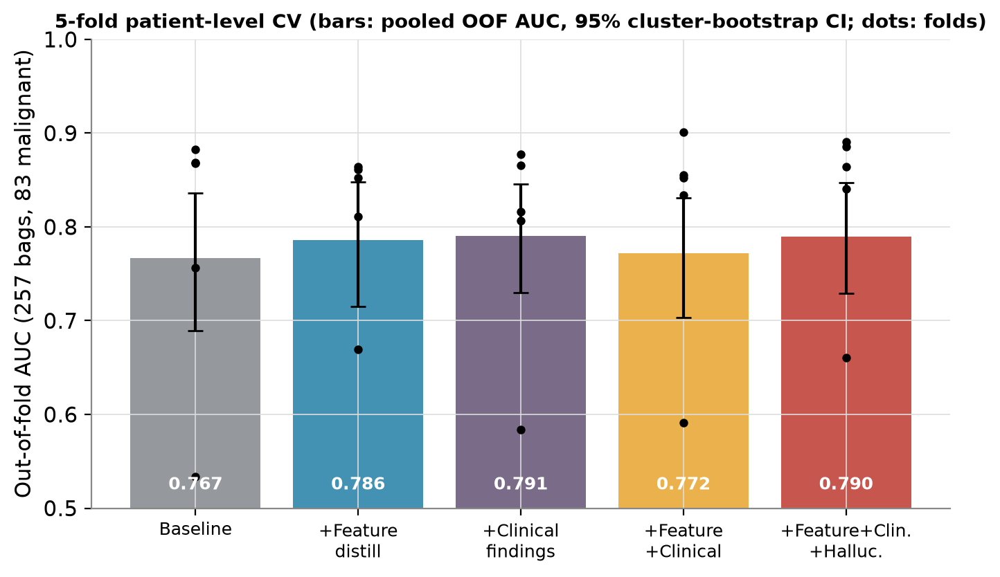</p>

<p align="center">
  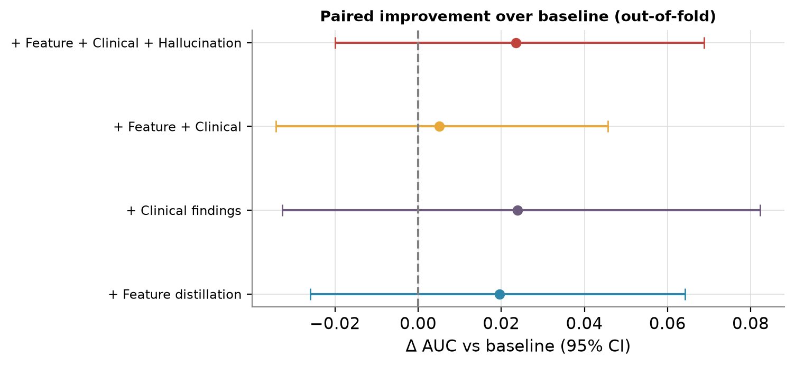
  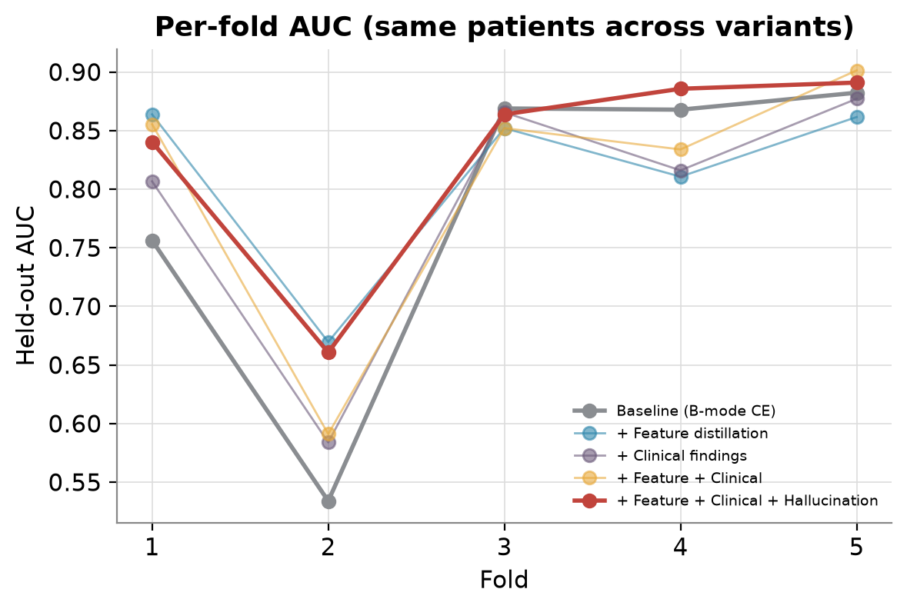
</p>

Fold 2 is a hard split for **every** model (AUC ≈ 0.53–0.67) – a reminder of how fragile small-cohort estimates are.

### C. Held-out test cohort, 5-fold-model ensembles

| Variant | Ensemble AUC | Single-model AUC | AUPRC | Acc | Brier | ECE |
|---|---|---|---|---|---|---|
| Baseline | 0.873 | 0.840 ± 0.071 | 0.539 | 0.821 | 0.127 | 0.146 |
| + Feature | 0.854 | 0.831 ± 0.018 | 0.499 | 0.851 | 0.126 | 0.174 |
| + Clinical | 0.834 | 0.798 ± 0.057 | 0.459 | 0.806 | 0.136 | 0.160 |
| + Feature + Clinical | 0.885 | 0.851 ± 0.027 | 0.540 | 0.791 | 0.130 | 0.166 |
| + Feature + Clinical + Hallucination | 0.855 | 0.835 ± 0.046 | 0.482 | 0.836 | 0.123 | 0.129 |

The baseline ensemble is already strong and the ordering does **not** match the CV ordering, so differences of ±0.02–0.04 here are within noise (11 positives).

<p align="center">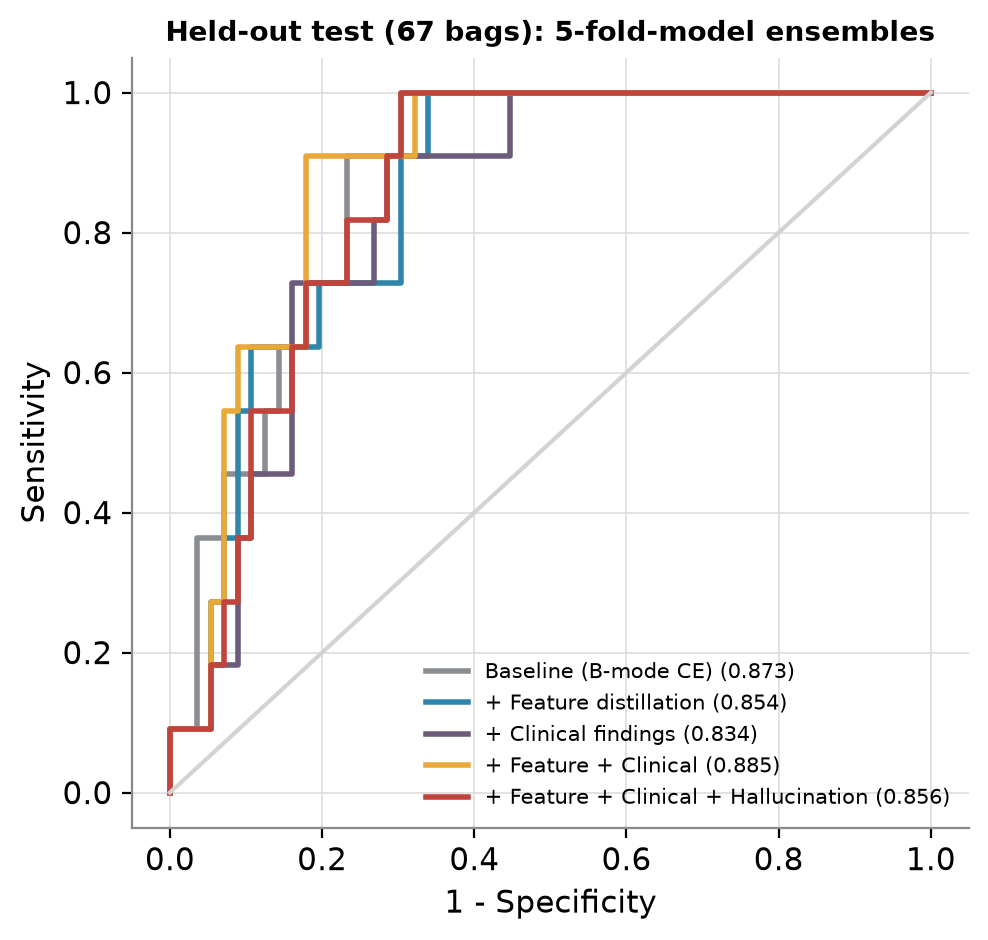</p>

### B. 3-seed ablation on the test set (11 variants)

| Variant | Test AUC (mean ± SD) | Ensemble AUC [95 % CI] |
|---|---|---|
| Baseline | 0.826 ± 0.015 | 0.833 [0.711, 0.932] |
| + KD logits | 0.820 ± 0.011 | 0.843 |
| + Feature distillation | 0.844 ± 0.004 | 0.852 |
| KD + Feature (Review 1 method) | 0.838 ± 0.032 | 0.852 [0.747, 0.935] |
| KD + Feature + teacher-confidence weighting | 0.817 ± 0.030 | 0.834 |
| Clinical only | 0.805 ± 0.077 | 0.857 |
| Hallucination only | 0.802 ± 0.042 | 0.830 |
| KD + Feat + TCW + Clinical | 0.816 ± 0.014 | 0.815 |
| **All losses at weight 1** | **0.702 ± 0.092** | 0.771 [0.639, 0.879] |
| Feature + Clinical *(post-hoc)* | 0.859 ± 0.029 | 0.869 [0.757, 0.955] |
| Feature + Clinical + Hallucination, low weights *(post-hoc)* | 0.852 ± 0.027 | 0.869 [0.764, 0.956] |

> *Post-hoc* variants were designed after seeing the first nine variants' test numbers, so Protocol A (which they were **not** tuned on) is the honest confirmation – and there the gain shrinks to +0.006 – +0.024 AUC.

<p align="center">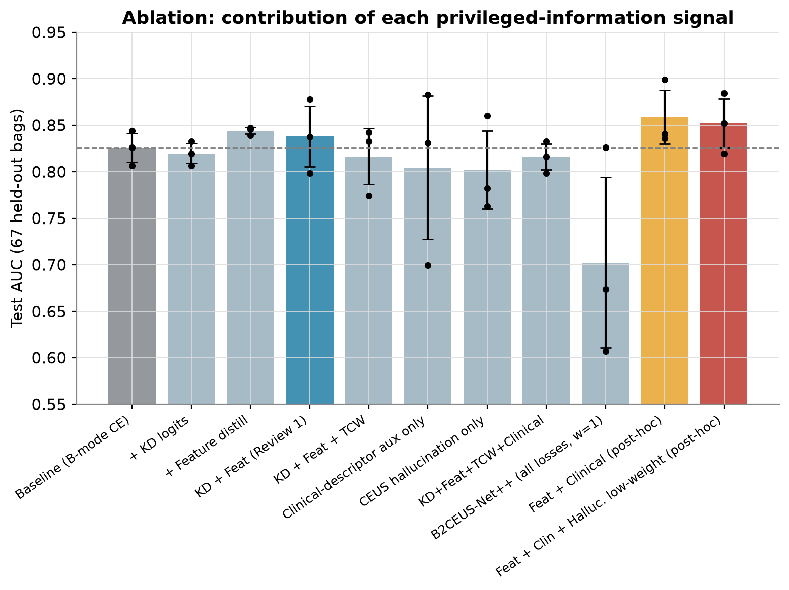</p>

### Hallucinated CEUS

SSIM 0.18 ± 0.06 · Pearson r 0.41 ± 0.20 against the real CEUS. The decoder captures the **coarse enhancement layout** (cystic voids dark, solid components bright) but not fine texture. Grad-CAM of the new model is **not** consistently better localised than the baseline (several benign cases attend to image corners), so no localisation claim is made.

<p align="center">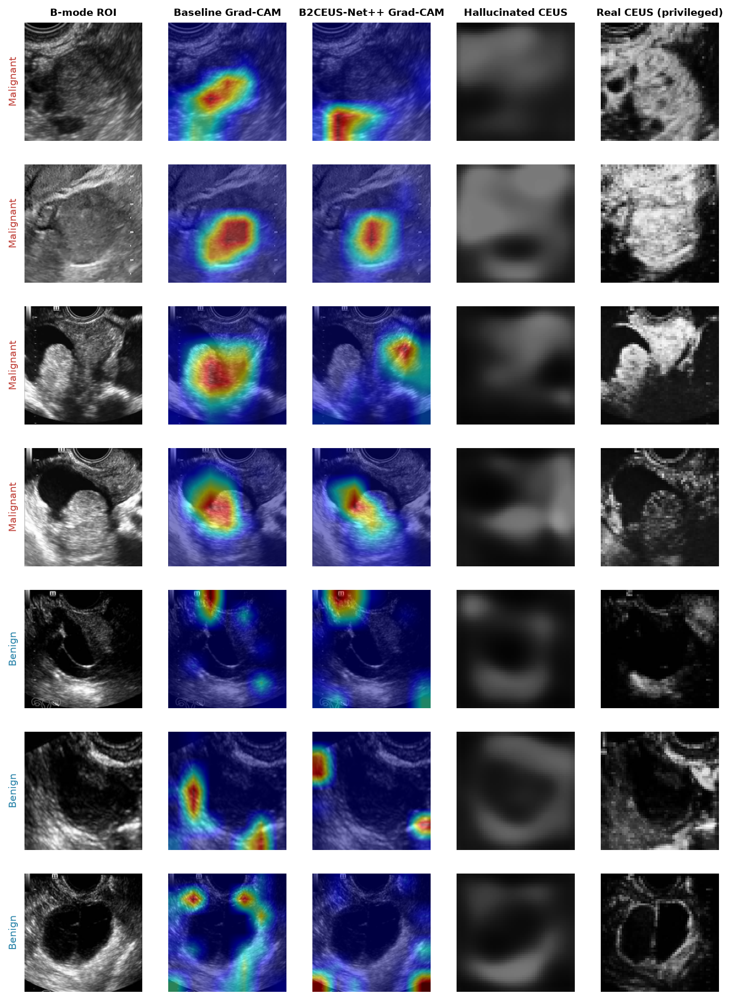</p>

### Uncertainty → "recommend real CEUS"

Using ensemble entropy + seed disagreement, accuracy rises from **0.78** (all bags) to **≈0.92** at 64 % coverage and **≈1.0** at 40 % coverage, i.e. the model can hand its most uncertain cases to real CEUS.

<p align="center">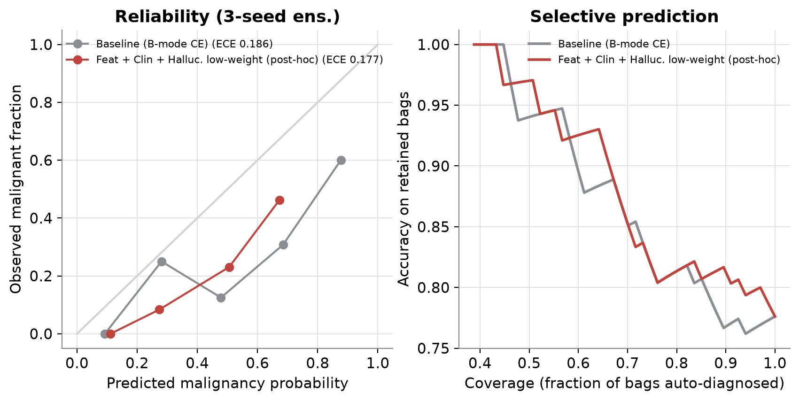</p>

---

## ✅ Honest take-aways

**What the evidence supports**
1. Privileged supervision moves AUC in the **same direction** across all three protocols (+0.01 to +0.05) and **improves calibration** (CV ECE 0.087 → 0.047–0.062).
2. Combining signals gives the best mean fold AUC (0.828) and the lowest fold-to-fold spread among the privileged variants except feature-only.
3. **Ensembling** (≈ +0.03 AUC, ~2× lower variance) and **calibration** are more reliable gains than any single loss term.

**What it does *not* support**
- **No improvement is statistically significant** – every 95 % CI on ΔAUC includes 0 (smallest paired p = 0.12 across folds, 0.17 on test). We deliberately did **not** keep tuning until a number crossed significance.
- This is **not** state-of-the-art and not a clinical validation.

**Negative results (also worth reporting)**
- Stacking *all* auxiliary losses at weight 1 collapses performance (AUC 0.70).
- Logit KD and teacher-confidence weighting did not help (teacher is fit on the same bags, so it is uniformly confident).
- The CEUS teacher is no better than the B-mode student → grayscale-collapsed single-frame CEUS adds little signal here; clinical findings are a cheaper, comparable privileged signal.

## ⚠️ Limitations

Single centre · only 11 malignant test bags · bag labels broadcast to frames · ROI crops use **expert masks** (end-to-end with predicted U-Net masks not yet tested) · CV uses 1 seed per fold · loss weights chosen heuristically · some patients contribute several bags (handled with patient-grouped folds and cluster bootstrap) · p-values not multiplicity-corrected.

**Next steps:** nested CV for loss weights, repeated CV with several seeds, end-to-end U-Net-ROI evaluation, keeping CEUS colour channels, external-centre validation.

---

## 🚀 Reproduce

```bash
python3 -m venv .venv && source .venv/bin/activate
pip install -r requirements.txt
```
Tested with Python 3.12 / PyTorch 2.11 on Apple Silicon (MPS); device auto-selects CUDA > MPS > CPU.

Expected data layout (not included; paths set in `configs/review1.yaml`):
```
Data/dataset/{Malignant,Benign}/<bag_id>/{Original,Mask}/...
Data/TestData/<bag_id>/{Original,Mask}/...
labels/clinical_data.csv, labels/test_clinical_data.csv
```

```bash
# Review 1: EDA → segmentation → baseline → distillation → Grad-CAM
python run_review1.py --config configs/review1.yaml

# Review 2
python -m experiments.train_variant --seeds 42 43 44                        # Protocol B
python -m experiments.train_variant --variants feat_clin feat_clin_recon --seeds 42 43 44
python -m experiments.cv                                                    # Protocols A / C
python -m experiments.analyze && python -m experiments.analyze_cv && python -m experiments.paper_diagrams
```

## 📁 Repository map

```
data/         loading, ROI cropping, mask handling, splits, EDA
models/       ResNet backbones, teacher, U-Net, heads (MC-dropout, CEUS decoder)
training/     segmentation, baseline, distillation (Review 1)
experiments/  Review 2: model variants, CV, analysis, diagrams
eval/ viz/    metrics, Grad-CAM, plots
results/      per-run JSON / CSV results and logs
paper_assets/ full master REPORT.md, all figures, all tables, raw per-bag predictions
docs/         Review 1 design notes and the earlier Review 2 report
```

Full write-up: [`paper_assets/REPORT.md`](paper_assets/REPORT.md) · Review 1 design notes: [`docs/REVIEW1_NOTES.md`](docs/REVIEW1_NOTES.md)
