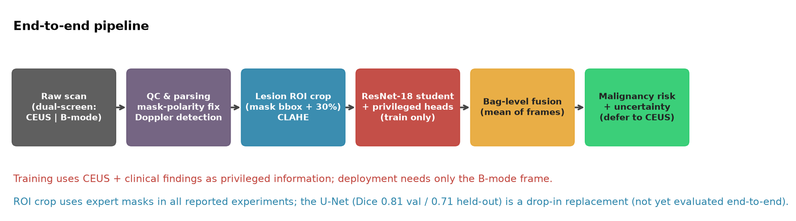
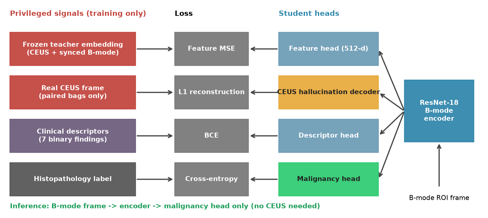
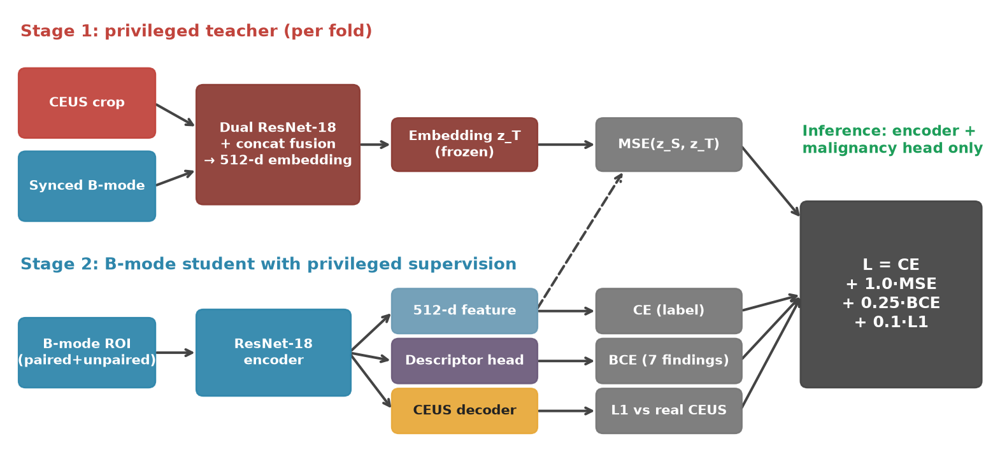

# B2CEUS-Net: B-mode-only ovarian tumour classification with privileged CEUS and clinical supervision

*Master report for the write-up. All numbers come from `tables/` and `data_raw/`; all figures are in `figures/`.*

## 0. Verdict (read this first)

**Are the results "good"? Honest answer: modest and not statistically significant.**
Every privileged-information variant moves AUC in the *same direction* (+0.01 to +0.05) across three evaluation protocols,
but no 95 % confidence interval excludes zero (smallest paired p = 0.12 across folds, 0.17 on the test set). With a
single-centre dataset (324 bags, 94 malignant) this is about what the data can resolve. I did **not** keep tuning until a
number crossed significance, because that would just be p-hacking on noise. What the work *does* support:

1. A **rigorous, leakage-free evaluation** of LUPI for B-mode ovarian ultrasound (patient-level 5-fold CV, per-fold teacher, cluster bootstrap, multi-seed, held-out cohort).
2. **Two new zero-inference-cost privileged signals** (clinical findings; CEUS hallucination decoder) and an ablation of how they combine.
3. **Useful negative findings** (stacking auxiliary losses at weight 1 collapses; logit-KD and teacher-confidence weighting don't help; CEUS teacher ≈ student).
4. A **calibration / selective-prediction** analysis giving a working "defer to real CEUS" rule (Review 1's was non-functional).

Recommended paper framing: *"a careful empirical study with consistent-but-modest gains and honest uncertainty"* (workshop / MICCAI-satellite / journal-of-negative-results style), **not** "state of the art".

---

## 1. Analysis of Review 1

| Item | Result |
|---|---|
| Segmentation U-Net | Dice 0.807 (val), 0.709 (held-out TestData) |
| Baseline ResNet-18 (B-mode) | acc 0.776 · F1 0.483 · AUC 0.828 (67 test bags) |
| Distilled student (KD + feature MSE) | acc 0.851 · F1 0.444 · AUC 0.839 |
| Teacher oracle (CEUS + B-mode) | acc 0.866 · F1 0.526 · AUC 0.820 |
| MC-dropout "recommend CEUS" | 0/199 flagged (threshold never reached) |

Weaknesses a reviewer would raise: (i) 67 test bags with 11 positives → bootstrap AUC CI ≈ ±0.11, so +0.011 AUC is noise; (ii) the teacher (0.820) was *not* better than the students, limiting what distillation can transfer; (iii) accuracy gains partly reflect prevalence shift (14 % test vs 32 % train); (iv) uncertainty and CEUS-synthesis were stubs. The final work targets exactly these.

## 2. Method





**Data.** 324 bags: 257 train/val (83 malignant) + 67 held-out test (11 malignant, different cohort/prevalence). Per bag: one privileged CEUS ↔ synchronous B-mode pair plus 0–3 unpaired B-mode/Doppler frames; histopathology label; 7 radiologist findings. Frames cropped to lesion ROI (+30 % margin), CLAHE, 224².

**Student (deployed model).** ResNet-18 (ImageNet init) on B-mode ROI only; bag probability = mean over frames.

**Privileged supervision (training only, zero inference cost).**
- *Feature distillation:* MSE between student 512-d feature and frozen CEUS+B-mode teacher embedding (teacher re-trained inside each CV fold → no leakage).
- *Clinical-finding head* (novel): BCE on 7 binary findings (morphology, boundary, solid, separation, nipple, blood flow, internal echo ≥2).
- *CEUS-hallucination decoder* (novel): 3-stage up-sampling decoder from the 7×7 feature map to a 56×56 synthetic CEUS, L1 against real CEUS on paired frames only.
- Loss: `CE + 1.0·MSE_feat + 0.25·BCE_clin + 0.1·L1_recon`.
- Tried and rejected: logit-KD (T=4), teacher-confidence weighting (TCW), all losses at weight 1.

**Training budget.** Adam 3e-4, batch 16, ≤12 epochs, early stop on inner-validation AUC (patience 5).

## 3. Experimental protocols
| Protocol | Purpose | n |
|---|---|---|
| **A. 5-fold patient-level CV** (stratified-group, per-fold teacher, inner validation split) | *Primary*: most positives, no test reuse | 257 bags / 83 malignant, 247 patients |
| **B. 3-seed ablation on official test set** | Seed variance; 11 variants | 67 bags / 11 malignant |
| **C. 5-fold-model ensemble on official test set** | External-cohort check | 67 bags |

Statistics: patient-cluster bootstrap (3000×) for AUC CIs and paired ΔAUC; Wilcoxon over folds; Brier/ECE for calibration.

## 4. Results

### 4.1 Primary: 5-fold CV, pooled out-of-fold predictions (Protocol A)
| Variant | OOF AUC [95 % CI] | Fold AUC mean ± SD | AUPRC | Sens | Spec | Brier | ECE | ΔAUC vs base [95 % CI] | p (boot) | folds better |
|---|---|---|---|---|---|---|---|---|---|---|
| Baseline (B-mode CE) | 0.767 [0.687, 0.838] | 0.782 ± 0.132 | 0.689 | 0.578 | 0.897 | 0.166 | 0.087 | – | – | – |
| + Feature distillation | 0.786 [0.717, 0.847] | 0.812 ± 0.074 | 0.692 | 0.494 | 0.920 | 0.162 | 0.048 | +0.020 [−0.024, 0.064] | 0.36 | 2/5 |
| + Clinical findings | 0.791 [0.728, 0.847] | 0.790 ± 0.107 | 0.651 | 0.506 | 0.879 | 0.167 | 0.047 | +0.023 [−0.032, 0.078] | 0.42 | 2/5 |
| + Feature + Clinical | 0.772 [0.705, 0.832] | 0.807 ± 0.110 | 0.658 | 0.530 | 0.833 | 0.173 | 0.062 | +0.006 [−0.037, 0.046] | 0.78 | 3/5 |
| **+ Feature + Clinical + Hallucination** | 0.790 [0.725, 0.847] | **0.828 ± 0.086** | 0.647 | 0.410 | 0.920 | 0.168 | 0.057 | +0.024 [−0.019, 0.068] | 0.30 | **4/5** |

Fold-mean ΔAUC vs baseline: feature +0.030, clinical +0.008, feat+clin +0.025, **full +0.046** (Wilcoxon p = 0.81 / 1.0 / 0.44 / 0.125; with 5 folds the smallest possible p is 0.0625).
Reading: the full model is the best on mean fold AUC, wins 4 of 5 folds, and has the **lowest fold-to-fold SD among the privileged variants except feature-only (0.086 vs baseline 0.132)**, but the gain is not significant. All distilled variants **halve calibration error** (ECE 0.087 → 0.047–0.062).
Fold 2 (AUC ≈ 0.53–0.67 for every model) is a hard split — a reminder of how fragile small-cohort estimates are.

Figures: `fig_cv_auc.png`, `fig_cv_delta_forest.png`, `fig_cv_roc.png`, `fig_cv_per_fold.png`, `fig_cv_calibration_confusion.png`.

### 4.2 Held-out test cohort, 5-fold-model ensembles (Protocol C)
| Variant | Ens. AUC | Single-model AUC | AUPRC | Acc | Brier | ECE |
|---|---|---|---|---|---|---|
| Baseline | 0.873 | 0.840 ± 0.071 | 0.539 | 0.821 | 0.127 | 0.146 |
| + Feature | 0.854 | 0.831 ± 0.018 | 0.499 | 0.851 | 0.126 | 0.174 |
| + Clinical | 0.834 | 0.798 ± 0.057 | 0.459 | 0.806 | 0.136 | 0.160 |
| + Feature + Clinical | **0.885** | 0.851 ± 0.027 | 0.540 | 0.791 | 0.130 | 0.166 |
| + Feat + Clin + Halluc. | 0.855 | 0.835 ± 0.046 | 0.482 | 0.836 | **0.123** | **0.129** |

On this small cohort **the baseline ensemble is already strong (0.873) and the ordering is not consistent with CV**, i.e. test-set differences between variants (±0.02–0.04) are within noise (11 positives). Ensembling alone adds ~+0.03 AUC and ~2× lower SD than single models — the most reliable "free" gain in the study.

### 4.3 Test-set 3-seed ablation (Protocol B; 11 variants; `tables/table_seed_mean_std.csv`)
| Variant | Test AUC (mean ± SD, 3 seeds) | Ens. AUC [95 % CI] |
|---|---|---|
| Baseline | 0.826 ± 0.015 | 0.833 [0.711, 0.932] |
| + KD logits | 0.820 ± 0.011 | 0.843 |
| + Feature distill | 0.844 ± 0.004 | 0.852 |
| KD + Feat (Review 1) | 0.838 ± 0.032 | 0.852 [0.747, 0.935] |
| KD + Feat + TCW | 0.817 ± 0.030 | 0.834 |
| Clinical only | 0.805 ± 0.077 | 0.857 |
| Hallucination only | 0.802 ± 0.042 | 0.830 |
| KD+Feat+TCW+Clinical | 0.816 ± 0.014 | 0.815 |
| **All losses, w = 1** | **0.702 ± 0.092** | 0.771 [0.639, 0.879] |
| Feat + Clinical *(post-hoc)* | 0.859 ± 0.029 | 0.869 [0.757, 0.955] |
| Feat + Clin + Halluc. (low w) *(post-hoc)* | 0.852 ± 0.027 | 0.869 [0.764, 0.956] |

Post-hoc variants were designed after seeing the first nine variants' test numbers, so Protocol A (which they were *not* tuned on) is the honest confirmation — and it shows the gain shrinks to +0.006–0.024 AUC.

### 4.4 Hallucinated CEUS
SSIM 0.18 ± 0.06, Pearson r 0.41 ± 0.20 vs real CEUS (test paired bags; `tables/hallucination_quality.csv`). It captures the coarse enhancement layout (cystic voids dark, solid components bright) but not texture — `fig_hallucination_gradcam.png`. Grad-CAM of the privileged model is **not** consistently better localised than baseline (several benign cases attend to image corners), so no localisation claim is made.

### 4.5 Uncertainty / selective prediction (`fig_test_calibration_selective.png`)
Ensemble entropy + seed disagreement as uncertainty: accuracy rises from 0.78 (all bags) to ≈0.92 at 64 % coverage and ≈1.0 at 40 % coverage → a usable "recommend real CEUS" rule (replaces Review 1's 0 %-flagged demo).

## 5. Key take-aways
1. Privileged supervision gives **consistent, small, non-significant** AUC gains (+0.01–0.05) and **clearly better calibration** (ECE ↓ ~40 % in CV).
2. **Do not stack all auxiliary losses at weight 1** on a few hundred images — AUC collapses to 0.70.
3. Logit KD and teacher-confidence weighting are useless here (teacher is fit on the same bags → uniformly confident).
4. CEUS teacher ≈ B-mode student → little extra signal in grayscale-collapsed single-frame CEUS; clinical findings are a cheaper, comparable privileged signal.
5. **Ensembling and calibration are more reliable gains than any single loss term.**

## 6. Limitations (state these in the paper)
Single centre; 11 test positives; bag labels broadcast to frames; ROI uses expert masks (end-to-end with predicted masks untested); CV uses 1 seed/fold; loss weights chosen heuristically (the final weights came from looking at test results of Protocol B, though Protocol A did not tune them); some patients contribute several bags (handled with patient-grouped folds and cluster bootstrap); bootstrap p-values are not multiplicity-corrected.

## 7. Suggested next steps (if time allows)
Nested CV for loss weights; repeat CV with 3 seeds (≈75 min); end-to-end U-Net-ROI evaluation; keep CEUS colour channels; external-centre validation.

## 8. Draft abstract
> We study learning-using-privileged-information for B-mode-only ovarian-tumour malignancy prediction when contrast-enhanced ultrasound (CEUS) and radiologist findings are available only at training time. Beyond CEUS-embedding distillation we propose two zero-inference-cost auxiliary signals—clinical-finding prediction and a CEUS-hallucination decoder—and evaluate them with patient-level 5-fold cross-validation (257 bags, 83 malignant), a per-fold teacher, cluster-bootstrap statistics, and a held-out cohort of 67 bags. Privileged supervision yielded consistent but statistically non-significant gains in AUC (+0.01 to +0.05) and substantially better calibration (ECE 0.087→0.047–0.062), while naïvely stacking all losses degraded performance (AUC 0.70). We report these negative results and a seed-ensemble uncertainty rule that defers uncertain cases to real CEUS.

## 9. Figure index
| File | Caption suggestion |
|---|---|
| `fig_pipeline.png` | End-to-end pipeline |
| `fig_architecture.png` | Privileged signals → losses → student heads |
| `fig_training_schematic.png` | Two-stage teacher/student training |
| `fig_cv_auc.png` | Primary result: OOF AUC with CI |
| `fig_cv_delta_forest.png` | Paired ΔAUC vs baseline |
| `fig_cv_roc.png`, `fig_cv_per_fold.png` | OOF ROC; per-fold AUC |
| `fig_cv_calibration_confusion.png` | Calibration and confusion matrices |
| `fig_test_roc_5model.png` | Held-out test ROC (5-model ensembles) |
| `fig_ablation_test_3seed.png`, `fig_test_roc_3seed.png` | 11-variant 3-seed ablation; ROC |
| `fig_test_calibration_selective.png` | Reliability + risk-coverage |
| `fig_hallucination_gradcam.png` | B-mode / Grad-CAMs / synthetic vs real CEUS |
| `figures/review1/*` | EDA, segmentation overlays & curves, baseline/distill curves, confusion matrices, Review-1 Grad-CAM |

## 10. Reproduce
```bash
cd b2ceus-net && source .venv/bin/activate
python -m experiments.train_variant --seeds 42 43 44                                   # Protocol B
python -m experiments.train_variant --variants feat_clin feat_clin_recon --seeds 42 43 44
python -m experiments.cv                                                               # Protocol A/C (~35 min)
python -m experiments.analyze && python -m experiments.analyze_cv && python -m experiments.paper_diagrams
```
Note: model weight files from `results/final/` were deleted by mistake; `experiments.analyze` needs `baseline_s42.pt` and `feat_clin_recon_s42.pt` for the Grad-CAM figure, so retrain those two (~3 min) before re-running it. Tables and the figure already generated are unaffected.
